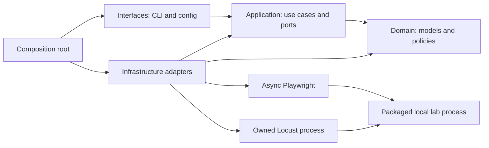

# Architecture baseline

Status: target design, 2026-10-27. Implementation has begun at T01; [PROJECT](PROJECT.md) records verified capabilities and pending gates. The structure and controls below remain design targets until their task evidence exists. Requirements: [SPEC](SPEC.md); rationale: [RESEARCH](RESEARCH.md), [ADR-0001](adr/0001-local-runtime-and-boundaries.md), [ADR-0002](adr/0002-toolchain-and-harness-continuity.md).

## System and dependencies

Use one local Python controller, one Asyncio event loop for browser work, a separately managed Locust process for HTTP work, and a separately managed single-process FastAPI lab. A run selects one engine. No network service, database, broker, container, or DI framework is required for the local foundation.



Arrows inside the Python package express code dependencies; the last two arrows are network interactions. The lab is an independent test target and does not import controller internals.

| Owner | Allowed dependencies | Must not depend on |
| --- | --- | --- |
| `domain/` | Standard library; domain itself | Application, adapters, interfaces, lab, Pydantic, browser/load/web/CLI frameworks |
| `application/` | Domain, application-owned ports, standard library/Asyncio | Playwright, Locust/gevent, concrete files/secrets/storage, CLI/config schemas, lab internals |
| `infrastructure/` | Application ports, domain, required libraries | Interfaces; other adapters via implicit globals |
| `interfaces/` | Application/domain; boundary parsers and presentation | Business decisions in CLI handlers; concrete construction outside `bootstrap.py` |
| `interfaces/bootstrap.py` | Concrete adapters and application use cases | Runtime service locator or global dependency mutation |
| `lab_app/` | FastAPI and its own synthetic fixtures/state | Controller domain, orchestrator, scenario implementations |

AST tests resolve absolute and relative imports and enforce this matrix, including optional/type-checking imports and imports hidden in helper modules. Add a failing architecture test before relaxing a boundary; a necessary change requires ADR review.

## Target layout

Create modules as their behavior is implemented, not as empty stubs. Names below describe responsibilities and may be split only when the slice needs it.

```text
AGENTS.md, CONSTRAINTS.md, Task.md
.agents/                         # existing six skills, references, license, provenance
pyproject.toml, uv.lock           # planned package, extras, tooling, exact resolution
src/web_stress_lab/
  domain/                        # accounts, experiments, scenarios, results, policies, errors
  application/
    ports.py                     # actual adapter seams
    run_experiment.py            # admission, lifecycle, supervision
    scheduling.py                # bounded queue, workers, timing
    leases.py                    # in-process exclusive identity ownership
  infrastructure/
    browser/                     # Playwright lifecycle, auth, context settings, metrics
      scenarios/                 # trusted registry, page objects, built-in workflows
    load/                        # child process adapter + approved Locust workloads
    storage/                     # run lock, manifests, raw records, atomic summaries
    secrets.py                   # explicit environment references
    resources.py                 # psutil/capability probes
  interfaces/                    # CLI, config schemas, presentation, bootstrap
  lab_app/                       # independent FastAPI app, packaged HTML/fixtures
experiments/                     # reviewed YAML definitions, local baseline by default
fixtures/                        # synthetic account/catalog examples; no real secrets
tests/                           # keep test_harness.py; add unit/architecture/integration/
                                 # e2e/fault_injection/ as behaviors exist
reports/                         # generated, private by default, ignored by Git
.local/                          # owned run lock and optional protected auth state; ignored
docs/                            # specification, conventions, design, safety, methodology
  adr/
  plans/implementation-plan.md   # the single plan and execution checklist
```

Two deliberate adaptations of Task.md: browser-dependent scenario plugins live inside infrastructure, so Playwright types do not leak into the application; the lab lives inside the installable package, so `stresslab lab start` works outside the source checkout. Root `lab_app/`, a parallel `tasks/` tree, and a generic `scenarios/base.py` hierarchy are unnecessary.

## Contracts and composition

Domain objects describe validated experiment policy, identity metadata/reference IDs, scenario capability/parameters, case outcome and measurement records. They are immutable when practical, serializable without secrets, and unaware of file formats or browser classes. No Pydantic models cross inward merely to reuse parsing convenience.

Application ports are small typed protocols introduced with their first adapter/test: `RunLock`, `ScenarioExecutor`, `LoadRunner`, `SecretProvider`, `ResultSink`, and `ResourceProbe`. Validated account catalogs can enter a use case as values; they need no generic repository abstraction. Introduce an additional port only when a concrete I/O boundary needs one.

`ScenarioExecutor` accepts a domain case and returns a domain outcome. Its Playwright implementation owns real Page/Context objects and calls trusted scenario handlers directly. Plugins use the real async Playwright API at the edge; do not wrap every locator method. Registry metadata fixes ID, engine, payload schema and `mutates_state`; experiment files cannot change that metadata or import executable modules.

The six browser responsibilities in Task.md are roles, not six obligatory classes: the engine owns browser/context lifecycle; a context factory applies explicit settings; an auth adapter resolves references and handles session state; the scenario executor drives handlers; metric helpers emit observations. Share one browser process when practical, with a fresh context per identity/case. Failed contexts are discarded rather than pooled across identities.

Config adapters safely load YAML/JSON, validate with Pydantic, and construct domain values. `bootstrap.py` wires dependencies explicitly. CLI handlers validate arguments, invoke one use case, and present outcomes; list/report/compare paths do not instantiate execution engines.

## Run, account, and cleanup ownership

1. Validate configuration, scope, supported features, output containment and finite limits before external effects. Acquire an OS-held exclusive run lock for the configured local workspace/state root; merely finding a PID/marker file is not a lock. Start an initial manifest and record provenance.
2. Select one engine. Browser mode creates a bounded producer/queue and a fixed worker set. Effective admission is the minimum of requested workers, origin allowance, and measured resource allowance; a semaphore without a bounded queue is insufficient.
3. A worker leases an identity atomically, executes one case in its own context, records a terminal outcome, and closes its owned context before releasing the lease. Lease ownership includes a token; old owners cannot release a newer owner's lease. Failures do not erase terminal history or silently unblock a challenged identity.
4. A run-level stop event prevents further admission. Queued/unstarted cases are accounted for, and active work enters the bounded cleanup path. Each successful queue `get` is acknowledged once. Safety/resource failures stop all workers; ordinary case failures remain local.
5. Finalize summaries only from recorded observations and mark the real run status. Release handles/lock after owned work is stopped. A reporting failure fails the run and preserves surviving raw data; it cannot become a successful report with missing rows.

Account leases are local in-memory state within this single controller. The OS run lock prevents overlapping controllers sharing that state root; it does not provide distributed or cross-workspace account ownership. Separate workspaces must use isolated identity catalogs/lab namespaces. No lease timeout may transfer an identity while old browser work can continue.

After a controller crash, an unlocked OS handle is not evidence that its browser requests or writes ended. A prior RUNNING/interrupted manifest, incomplete cleanup, or unknown write outcome blocks reuse of the affected catalog/target until recovery checks establish owned-process termination and reconcile effects. Never clear that condition solely because a PID disappeared or a timer expired; record the recovery decision.

### Playwright stop boundary

The official library documentation warns against cancelling an active Playwright call. Use cooperative stop between actions and native navigation/action timeouts. If a caller can be cancelled, the adapter retains and shields the in-flight operation, then drains/observes it during shutdown; shielding alone is not cleanup. Cleanup has its own deadline and closes owned contexts/browser/driver. Do not race a new action against an old operation or unconditionally `Task.cancel()` every browser worker.

When the deadline is exhausted, stop only proven owned processes, record incomplete cleanup and unknown write outcomes, and fail the relevant gate. Test cancellation during navigation, action submission, queued work and cleanup on Windows before treating the controller as reliable. An Asyncio fake cannot establish this guarantee; this is an early integration gate in T06.

### Locust process boundary

Launch an approved packaged workload through `sys.executable -m locust` with an argument list, fixed supported flags, a curated environment, and finite headless run/stop deadlines. The controller never imports Locust/gevent. Drain stdout/stderr safely, retain the process handle, ingest statistics, and await termination; no process-name-wide killing.

Use one Locust child on Windows. Workload stages control users/spawn rate; an explicit shared limiter in that child gates individual requests against the experiment-wide cap and request count. Per-user `wait_time` is not a global RPS guarantee. Parent resource/deadline monitoring is a second guard. Abort with a structured failure if the limiter or enforcement capability is unavailable. Advanced Linux/Docker distributed operation needs separate instructions and authorization, not a silent fallback.

## Local lab and data

The lab binds loopback, uses synthetic namespaces, runs one server process, and keeps test state in memory. Atomic state updates cover mutation, operation-ID deduplication, and resulting fixture state together. Restarts reset the lab; there is no product database/migration decision. Reset/fault controls are authenticated, scoped to the run's fixture namespace, and unavailable as arbitrary external cleanup APIs.

Keep secrets and optional persisted auth state in protected local storage outside reports/source control. The report sink is a single writer for a run: append raw measurements and sanitized events, then create atomic derived JSON/HTML outputs. Use exclusive run-directory creation, versioned schemas and explicit interrupted/partial statuses. Metric absence is represented with a reason, not synthetic zeros. See [SECURITY](SECURITY.md) and [methodology](EXPERIMENT-METHODOLOGY.md) for the authoritative policies.
